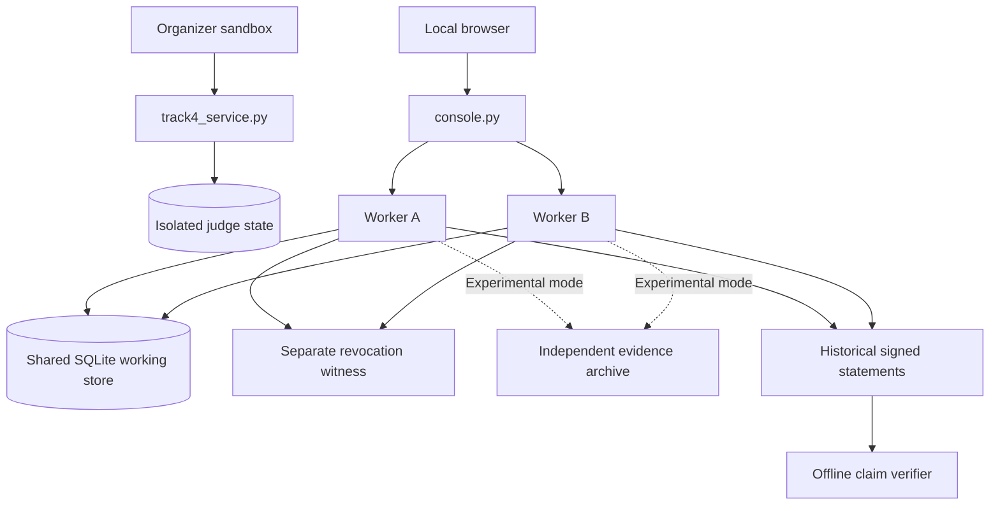

<div align="center">

# Recovery Console

**Security Assurance Laboratory · DevForge Track 4**


Protect files. Revoke devices. Recover from interrupted rotations. Verify the evidence.

[Quick start](#quick-start) · [Try the demo](#try-the-demo) · [Automated assessment](#automated-assessment) · [Architecture](#architecture) · [Troubleshooting](#troubleshooting)

</div>

## Quick start

Choose your operating system below. You only need Git, Python 3.12 and a browser.
No API keys, npm, cloud services, database server or manual worker setup.

| Operating system | Setup |
| --- | --- |
| macOS | Native POSIX setup instructions; not yet independently verified on macOS |
| Windows | Ubuntu 24.04 through WSL2; native Windows is not supported by this guide |
| Linux | Recommended; release tested on x86_64 Linux, Python 3.12.14 |

<details open>
<summary><b>macOS — install and launch</b></summary>

### Step 1 — Install Python and Git

Open Terminal. If you do not have Homebrew, follow the instructions at [brew.sh](https://brew.sh/).

```bash
brew install python@3.12 git
```

### Step 2 — Download and install

```bash
git clone https://github.com/KillerMeritus/devforge-key-identity-guard.git
cd devforge-key-identity-guard
python3.12 -m venv .venv
source .venv/bin/activate
python -m pip install -r requirements.txt
python -m pip check
```

### Step 3 — Start

```bash
python console.py
```

Open [http://127.0.0.1:8080](http://127.0.0.1:8080).

macOS is a proposed native setup, not a tested release platform. If pinned
crypto dependencies or scenarios fail, use a Linux VM with the Linux instructions
below rather than downgrading dependencies.

</details>

<details>
<summary><b>Windows — install and launch using WSL2</b></summary>

### Step 1 — Install Ubuntu

Open **PowerShell as Administrator** on a supported Windows 10/11 system.

```powershell
wsl --install -d Ubuntu-24.04
```

Restart Windows if prompted. Open **Ubuntu 24.04** from the Start menu and
complete the initial username/password setup. If needed, run
`wsl --list --online` in PowerShell to confirm the distribution name.

### Step 2 — Install Python and Git

Run the remaining commands in the **Ubuntu terminal**, not PowerShell.

```bash
sudo apt update
sudo apt install -y git python3.12 python3.12-venv
cd ~
```

### Step 3 — Download and install

```bash
git clone https://github.com/KillerMeritus/devforge-key-identity-guard.git
cd devforge-key-identity-guard
python3.12 -m venv .venv
source .venv/bin/activate
python -m pip install -r requirements.txt
python -m pip check
```

### Step 4 — Start

```bash
python console.py
```

Open [http://127.0.0.1:8080](http://127.0.0.1:8080) in your Windows browser.
Keep the Ubuntu terminal running. WSL localhost forwarding must be enabled.

The project uses POSIX process termination and locking. Do not run the native
Windows Python interpreter for this demonstration.

</details>

<details>
<summary><b>Linux — install and launch (Ubuntu 24.04)</b></summary>

### Step 1 — Install Python and Git

```bash
sudo apt update
sudo apt install -y git python3.12 python3.12-venv
```

Other Linux distributions: install Git, Python 3.12 and venv using your package manager.

### Step 2 — Download and install

```bash
git clone https://github.com/KillerMeritus/devforge-key-identity-guard.git
cd devforge-key-identity-guard
python3.12 -m venv .venv
source .venv/bin/activate
python -m pip install -r requirements.txt
python -m pip check
```

### Step 3 — Start

```bash
python console.py
```

Open [http://127.0.0.1:8080](http://127.0.0.1:8080).

</details>

### You're ready

Expected terminal output:

```text
Recovery Console: http://127.0.0.1:8080
```

Use this exact URL (not localhost). Keep the terminal open. The application
automatically starts local workers and creates disposable synthetic data when
you select a scenario. Stop it with Ctrl+C.

**Already installed?** In your macOS, Linux or Ubuntu terminal:

```bash
cd devforge-key-identity-guard
source .venv/bin/activate
python console.py
```

Run this from the directory containing your checkout, or use its absolute path.

## Try the demo

Start with the **Recovery Lab**. Predict the surviving version, run the scenario,
then inspect the actual evidence.

| Try this | Expected outcome |
|---|---|
| Before commit | v1 survives the process kill |
| After commit | v2 survives; new v1 requests are rejected |
| Device revocation | Both workers deny the revoked device; teammate access remains |
| Expired or consumed approvals | Invalid approval rejected |
| Competing rotations | One eligible rotation commits |
| Damaged backup | Original accepted; damaged copy rejected |
| Evidence Passport | Original historical statements authenticate; modified copy rejected |
| Operational audit monitor | Authenticated findings and observed denial containment |
| Detection View | Synthetic contextual findings and clock uncertainty |
| Security Time Machine (experimental) | Stale state quarantined; eligible current snapshot restored |

HTTP 200 = allowed. HTTP 403 = explicit denial. HTTP 503 = unavailable / fail closed.
The baseline Recovery Lab is the recommended judging path.

<details>
<summary><b>Run without a browser</b></summary>

```bash
python demo_cli.py --kill-at pre
python demo_cli.py --kill-at post
python detection_cli.py
```

The first two commands finish with PASS and recovered v1 and v2 respectively.
Add `--json` to export recovery results.

</details>

## Architecture



Two worker processes run on one host, not a distributed cluster.
The organizer adapter is a separate execution path.

## Automated assessment

<details>
<summary><b>Official adapter and validator commands</b></summary>


The official entry point is [track4_service.py](track4_service.py), in the
repository root. It accepts one UTF-8 JSON request on stdin and emits one JSON
response on stdout. It does not require the browser console or HTTP workers.

The adapter uses Python's standard library and `pqcrypto==0.4.0`; the full
requirements file also installs the dependencies needed for the demonstration.
The organizer supplies a writable `TRACK4_STATE_DIR` for persistent state across
invocations. Use an isolated writable directory for manual adapter runs.
Do not reset it between requests in the same test. The source tree can be
read-only after setup.

To reproduce the public organizer validator locally, keep the toolkit outside
this repository:

```sh
git clone https://github.com/ScalerOpenSourceLabs/Track-4-Toolkit.git ../Track-4-Toolkit
toolkit_dir="$PWD/../Track-4-Toolkit"
git -C "$toolkit_dir" checkout --detach 8901dfbdbfe048853e0bfa25b60583d1e6617a63
PYTHONDONTWRITEBYTECODE=1 python "$toolkit_dir/validate.py" --entry ./track4_service.py
```

If the toolkit is already cloned, skip its clone command and set
`toolkit_dir` to its existing absolute path. Expected: 22 passing public
checks and “Local scenario passed”. This public validator does not establish
hidden-assessment results.

</details>

## Testing

<details>
<summary><b>Full release checks and optional browser testing</b></summary>


Run from the repository root with the virtual environment active. The toolkit
is only needed for the public validator and organizer practice fixtures.

```sh
python -m unittest discover -s tests -v
PYTHONPATH=. python tests/reviewer_worker_core.py
PYTHONPATH=. python scripts/smoke_archive_ops.py
```

The frozen engineering release
[`27d5a8b4ce45ce5666cd1134a6f12fe4d445e524`](https://github.com/KillerMeritus/devforge-key-identity-guard/commit/27d5a8b4ce45ce5666cd1134a6f12fe4d445e524)
reported 96 application tests, seven reviewer regressions and 22 organizer
checks passing in the pinned runtime. This README clarification does not
change the application code or imply a fresh test run.

For the organizer practice detector replay (after step 4):

```sh
python detection_cli.py --practice "$toolkit_dir/practice"
```

For optional automated browser checks, first stop any running console so that
port 8080 is free. Playwright is not needed for manual browser use.

```sh
python -m pip install playwright==1.62.0
python -m playwright install chromium
python scripts/smoke_console.py
```

On Linux, Chromium may also require system libraries; follow Playwright's
dependency-installation guidance for your distribution. If Chromium is
already installed, use `python scripts/smoke_console.py --chromium /path/to/chromium`.


</details>
## Troubleshooting

<details>
<summary><b>Offline installation and common problems</b></summary>


For offline installation, stage compatible wheels on a connected Linux machine
with the same Python version and architecture before going offline:

```sh
python -m pip download -r requirements.txt -d /path/to/wheelhouse
```

On the offline machine, after creating and activating the virtual environment:

```sh
python -m pip install --no-index --find-links /path/to/wheelhouse -r requirements.txt
python -m pip check
```

The checkout and any optional toolkit or browser-test dependencies must also
be staged separately.

| Problem | Resolution |
|---|---|
| python3.12 not found or venv creation fails | Install Python 3.12 and its venv support for your Linux distribution. |
| ImportError or missing ML-KEM / ML-DSA modules | Activate the project environment and reinstall the pinned requirements. Check `python --version` and `python -m pip check`. |
| Console cannot bind to port 8080 | Stop the existing console or other process using that port, then restart. |
| Browser returns 404 or 403 | Open the exact URL http://127.0.0.1:8080 directly; do not use a proxy or alternate hostname. |
| Scenario reports FAIL or UNAVAILABLE | Inspect the console terminal and displayed evidence; rerun the disposable fixture after resolving the error. Do not treat unavailability as successful authorization. |
| Toolkit path not found | Use the absolute path to the separately cloned toolkit. |
| Browser smoke cannot launch Chromium | Install Playwright's Chromium and its system dependencies, or supply an existing Chromium executable. |


</details>
## Technical documentation

- [Project overview](PROJECT_OVERVIEW.md)
- [Official objective coverage](OBJECTIVE_COVERAGE.md)
- [Measured results](METRICS.md)
- [Judge demo guide](JUDGE_DEMO_GUIDE.md) and [technical Q&A](JUDGE_QA.md)
- [Engineering handoff](ENGINEERING_HANDOFF.md)
- [Evidence and acceptance](EVIDENCE.md)
- [Black-box adapter coverage](HIDDEN_ASSESSMENT.md)
- [Threat model metadata](threat-model.json)

The following sections describe the advanced architecture, manual archive
operation and additional verification commands. They are not required to
launch the standard demonstration.


<details>
<summary><b>Advanced architecture, cryptography, archive commands and security boundaries</b></summary>

### Design and evidence limits

- The organizer's actor-level API and the demo's device-level API share
  SQLite transaction helpers. The judge uses the caller identity supplied
  by its sandbox. The demo derives roles from randomly provisioned bearer
  credentials. Operator evidence is role-restricted.
- The demo has two independently running processes on one host with one
  SQLite authority. Report measured time from when the server observes
  the revocation commit to each node's first explicit denial. The probes
  are local and launched in parallel after the revoke response. These
  measurements do not establish distributed replication or host failover.
- A read authorized before a transaction commits may finish with that
  snapshot. Key rotation updates ciphertext, version, approval consumption,
  and audit evidence in one transaction. An authenticated version mismatch
  rejects new requests after cutover. The harness pauses before the write
  transaction and after commit to prove availability at those boundaries.
  Reads also append audit rows, so SQLite can serialize them behind a
  writer during the commit transaction.
- Key backups are encrypted and verified against the active asset and
  version. The demo uses a generated damaged fixture, because the toolkit
  checkout has no `practice/bad_backup.bin`. Baseline key-backup verification does not
  restore a whole store or replace live keys. Experimental verified snapshot
  restoration is described below.
- The audit chain with authenticated head detects edits or tail deletion
  when the head survives. The external revocation checkpoint covers stale
  file snapshots as described below.
- The detector evaluates one event at a time within a finite replay. It
  emits confirmed approval and correlation findings once their evidence
  arrives. A generic access-review fallback waits for replay closure so
  a delayed role-change event can provide a more specific explanation.
  Each corrected timestamp has a ±125 ms uncertainty range. When ranges overlap,
  the detector records uncertainty and avoids claiming the change
  preceded the read. Events outside the five-second timestamp-to-receipt tolerance
  cannot supply path or causal evidence.
- The mixed replay scores event ID and rule pairs. Latency starts at
  receipt of the last required evidence item and ends at local detector
  emission. Use `python detection_cli.py --real-time` to preserve fixture
  receipt intervals. The benchmark covers four measured rules, excludes
  the close-of-input fallback, and does not include a live collector,
  external delivery, or production-scale state retention.
- ML-KEM protects the organizer interoperability exchange. File data in
  the demo is encrypted at rest. Messaging is deliberately unsupported and
  an authenticated request to `POST /message` produces an audited 501.
- Test with synthetic data and trusted local processes only. The project
  does not establish production security, offline host recovery, or
  messaging features such as forward secrecy.

### Post-quantum audit verification

The local demo provisions a separate ML-DSA-65 signing seed for each
worker and pins each public key to its node at setup. After recovery the
client requests a fresh challenge-bound signature from each node on its
own recorded revocation denial. The attestation route requires an active
operator and an intact audit chain. A request to sign a different node's
record returns HTTP 409. The verifier checks the expected node, pinned key,
challenge, and request ID before reporting success.

The demo uses separate signing keys on a shared host, with both seed files
in the private demo state directory. It does not demonstrate process-level
key isolation. ML-KEM-768 handles the
organizer's separate protected-read exchange.

### Revocation survives old snapshots

The demo provisions an authenticated checkpoint store in a separate SQLite
file, outside the file database's restore boundary. It advances the
checkpoint to the revocation's audit sequence and tag before acknowledging
a revoke. In each worker, protected operations require that record to be
present in their current database view. Missing, tampered, or mismatched
checkpoints prevent file reads and signed evidence. HTTP 503 means the
node cannot serve that state. It is distinct from an explicit revocation
denial on a healthy node.

Run `python -m unittest discover -s tests -p test_rollback.py -v` to restore
a pre-revocation backup with the witness preserved and exercise both HTTP
workers. The test restores the current database afterward, then confirms
the teammate can read and the revoked laptop cannot.

The witness is kept on the demo host. The guarantee covers snapshots older
than the latest checkpointed revocation when the witness survives.
Rollback of the witness itself, rotation-only rollback after that
revocation, and automatic reconciliation are outside this milestone. An
interrupted revocation can leave the checkpoint ahead of the file store.
In that case the workers withhold protected operations pending trusted
recovery.

### Archive-enabled worker integration

The two HTTP workers support an opt-in archive mode. In that mode, protected
reads and fresh evidence require verified current rows and a durable archive
confirmation. Revocation, rotation, and enrolment require an `Idempotency-Key`
header. Reuse the original key when retrying the same request. A successful
enrolment retry returns the device reference without redisclosing its token.

Provision a stopped, known-good demo state once, then start both workers on
the same directory. The investigator credential path must be a new file kept
outside the working database's restore boundary.

```sh
python archive_ops.py --state "$state" provision "$investigator_credential_file"
python node_server.py --archive --state "$state" --node A --port 8081
python node_server.py --archive --state "$state" --node B --port 8082
```

Keep `archive.required` and the archive directory outside any restore of
`demo.sqlite`. Both workers must use `--archive` for that state directory.
An existing archive directory also binds the mode for fixtures provisioned
before the marker was introduced. Run the baseline from a separately
provisioned directory with its own working database and witness.

`GET /historical/{producer}/{event_id}` accepts the independently scoped
investigator bearer credential and returns the original canonical archive event
and its receipts. The endpoint remains available during working-store
quarantine when the archive and investigator grant verify.

From the trusted offline environment, inspect the pending receipt and authorize
recovery only after the coordinator verifies the corresponding committed rows
and transaction marker. Provide the separately authorized actor with the
credential file through the trusted operator channel.

```sh
python archive_ops.py --state "$state" status
python archive_ops.py --state "$state" authorize-recovery "$pending_tag" "$recovery_actor" "$recovery_credential_file"
python archive_ops.py --state "$state" recover "$pending_tag" "$recovery_credential_file"
python archive_ops.py --state "$state" restore "$verified_snapshot"
```

The recovery and restore commands verify under the same lock used by the
workers. To export a verified current snapshot, use
`python archive_ops.py --state "$state" export "$verified_snapshot"` with a new
private destination. Restore requires the exact retained checkpoint, original
keys, witness and independent archive. Even a subsequent read can make an
older snapshot ineligible. Stop both workers before restoring a missing working
database; ensure no stale SQLite sidecars remain. A live worker can record `ABORTED` when SQLite rolls back its open
transaction and the preceding application state verifies. If a killed worker
left a pending receipt without positive evidence of commit or rollback, both
workers return HTTP 503 for protected operations. Retain the stores for
investigation. The experimental mode currently has no reconciliation path
for that ambiguous case.

Producer credentials expire one hour after archive provisioning by default.
Worker restarts use the original expiry. Scoped recovery can finalize a
verified commit after producer expiry. Returning an expired producer to
service requires credential renewal, which is outside this prototype.

Run the independent reviewer and smoke checks from the repository root.
The console smoke script uses Playwright and its installed Chromium by
default. Use `--chromium PATH` to select an existing executable.

```sh
PYTHONPATH=. python tests/reviewer_worker_core.py
PYTHONPATH=. python scripts/smoke_archive_ops.py
python scripts/smoke_console.py
```

### Sprint demo commands

Run from a clean checkout with the pinned requirements installed. The normal
entry points continue to use the reviewed baseline controls.

```sh
python demo_cli.py --kill-at pre --json
python demo_cli.py --kill-at post --json
python console.py
```

Open `http://127.0.0.1:8080`. Start in **Recovery Lab**. Select a crash
checkpoint, predict a version, run it, and open a verified event in the
Evidence Explorer. The browser's Detection View uses a bounded synthetic
replay and a disposable independent evidence archive. Security Time Machine
uses a separate disposable archive-mode working store. It demonstrates
stale-snapshot quarantine and restoration from a verified current snapshot.

For persistent **experimental replay evidence**, use a fresh private
directory path outside the repository. A subsequent invocation with the
same input and path verifies and reuses the receipts. A different payload
for a retained source ID is rejected.

```sh
python detection_cli.py --practice ../Track-4-Toolkit/practice \
  --replay-archive "$HOME/devforge-detector-evidence"
python -m unittest discover -s tests -v
PYTHONPATH=. python tests/reviewer_worker_core.py
PYTHONPATH=. python scripts/smoke_archive_ops.py
python scripts/smoke_console.py
```

The detector archive is a dedicated SQLite evidence store using the same
authenticated receipt implementation as the recovery archive. It does not
consume live worker traffic. It retains synthetic or organizer practice event
fields, so keep the entire state directory private, including its credential
files. Archive receipts authenticate record provenance within this fixture.
Portable ML-DSA signatures for archive receipts and producer renewal remain out of scope. Separate baseline worker Evidence Passports are supported.


### Release verification

After setup, run these checks from the repository root. Set `toolkit_dir`
to the path of the pinned toolkit checkout if it is stored elsewhere.

```sh
PYTHONPATH=. python tests/reviewer_worker_core.py
python -m unittest discover -s tests -p test_root_adapter_contract.py -v
python demo_cli.py --kill-at pre --json
python demo_cli.py --kill-at post --json
PYTHONPATH=. python scripts/smoke_archive_ops.py
PYTHONPATH=. python scripts/evaluate_detector.py --baseline 4f75ed2
PYTHONPATH=. python scripts/evaluate_detector.py --expanded --baseline 4f75ed2
PYTHONPATH=. python scripts/measure_rubric.py --practice "$toolkit_dir/practice"
```

For the browser smoke check, install Playwright and its Chromium separately
from the judging dependencies.

```sh
python -m pip install playwright==1.62.0
python -m playwright install chromium
python scripts/smoke_console.py --screenshots "$PWD/../devforge-screenshots"
```

If Chromium is already installed, pass `--chromium /path/to/chromium`.
The local console binds to 127.0.0.1 on port 8080. Other fixture processes
use temporary state and ephemeral ports.

- [Project overview](PROJECT_OVERVIEW.md)
- [Official objective coverage](OBJECTIVE_COVERAGE.md)
- [Measured results](METRICS.md)
- [Judge demo guide](JUDGE_DEMO_GUIDE.md) and [technical Q&A](JUDGE_QA.md)
- [Evidence and acceptance](EVIDENCE.md)

See the [black-box adapter coverage](HIDDEN_ASSESSMENT.md) for test functions and observed contract results.

### Baseline persisted-state trust boundary

The baseline trusts the SQLite writer and filesystem permissions for device,
grant and approval rows. The authenticated audit chain verifies recorded
decisions. It cannot independently attest the current authorization tables.
An asset's authenticated ciphertext binds its identifier and version, but
does not establish that it is the newest genuine ciphertext. The revocation
witness anchors a prior audit checkpoint. Independent current-state comparison
belongs to the experimental archive workflow.

</details>
